# 02-wireshark-ufw-traffic-lab
Basic work with Wireshark.

## Goal
Capturing packets with Wireshark when connecting to opened and closed ports.

## Environment
- Host: Windows 10, VirtualBox 7.2.22
- VM1: Ubuntu 26.04, name: mainvm, IP 192.168.56.101
- VM2: Ubuntu 26.04, name: subvm, IP 192.168.56.102
- Network: Host-Only

## Wireshark installation and setup
Installing Wireshark and making sure it works successfully

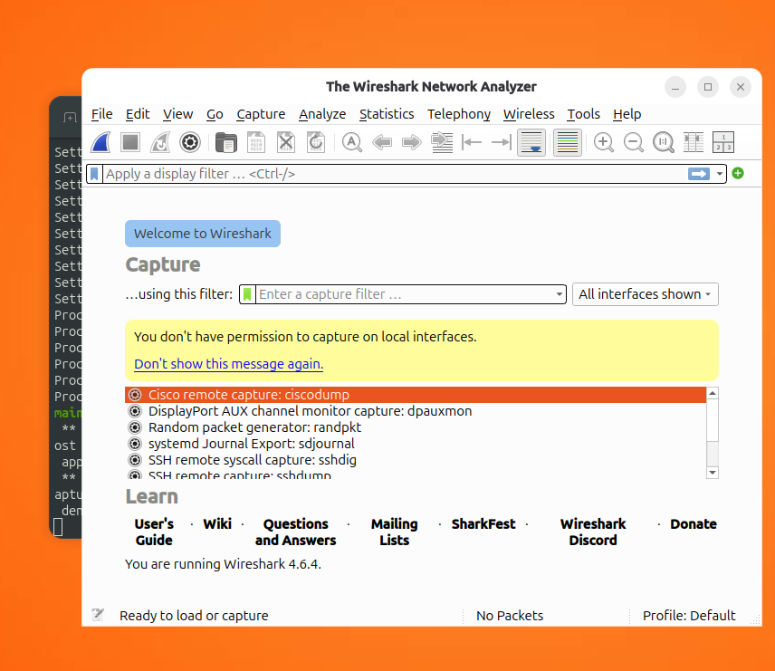
```
sudo apt update && apt upgrade
sudo apt install wireshark
wireshark
```
---
Adding user to wireshark group, allowing WS capturing traffic without starting up root session.

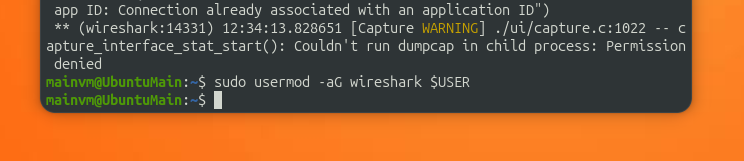
```
sudo usermod -aG wireshark $USER
```
After that re-entering current user session to apply group policies

---
Looking up for an interface that connects to inner traffic

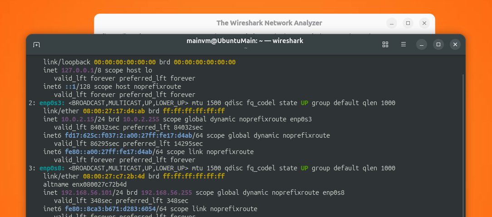
```
ip a
```
Interface named `enp0s8` has an ip 192.168.56.101, so i'll capture it's traffic

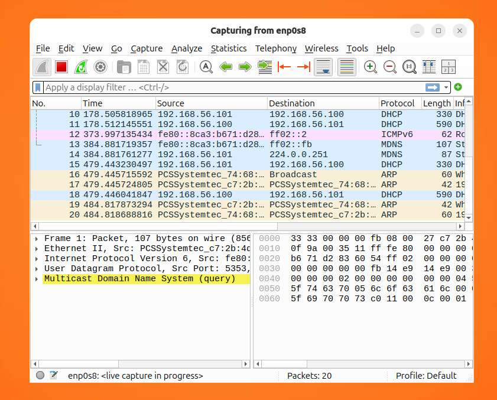

## Ping capturing and analysis
Verifying that ufw on subvm still works, checking up that ip still the same, then ping subvm from mainvm

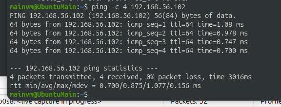
```
ping -c 4 192.168.48.102
```
Then typing in `icmp` filter in Wireshark and looking up for ping being registered

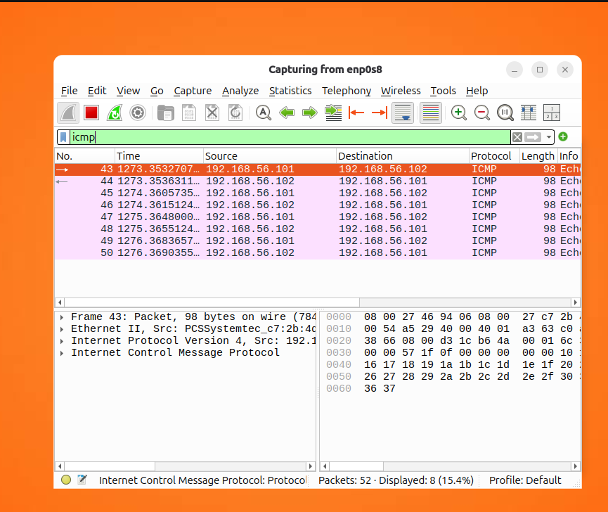
Seeing 8 lines sorted by ICMP protocol, 4 stands for main>sub ping, 4 stands for sub>main replies 

## Connecting to locked tcp port
Now enabling test server on port 8000 on subvm and trying to curl it from mainvm

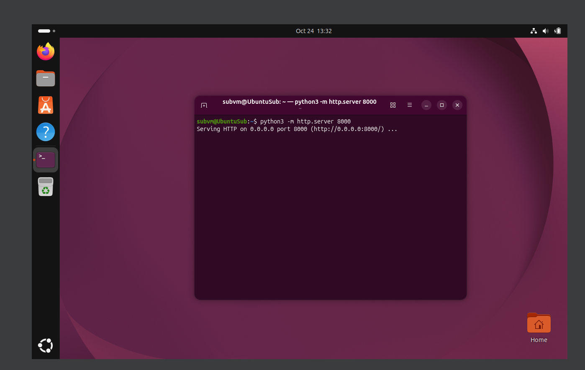

```
python3 -m http.server 8000
```
Then renewing capture on Wireshark 

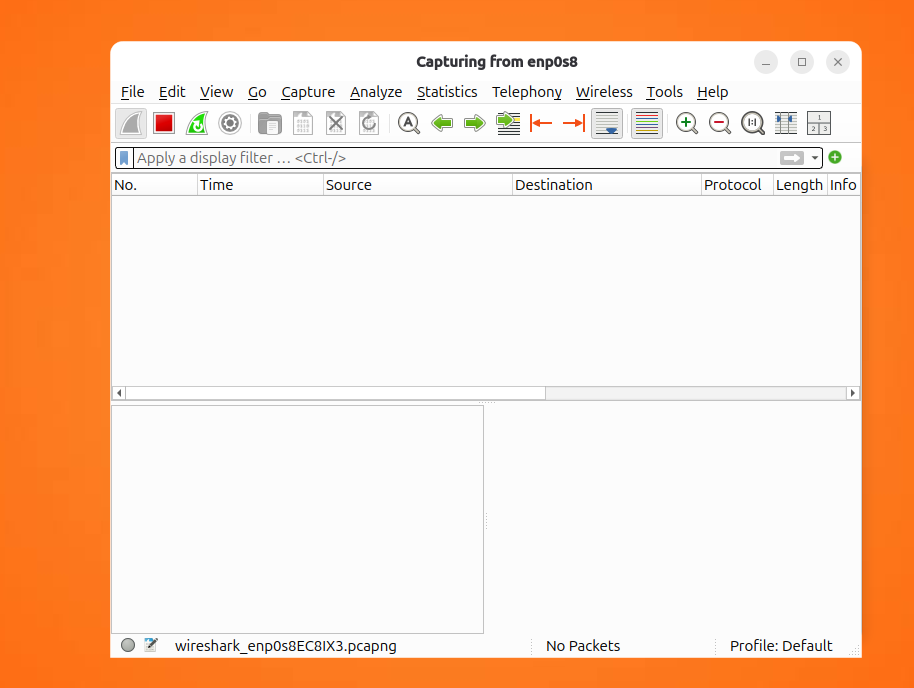

And trying to curl (+ applying `tcp.port` filter in WS)

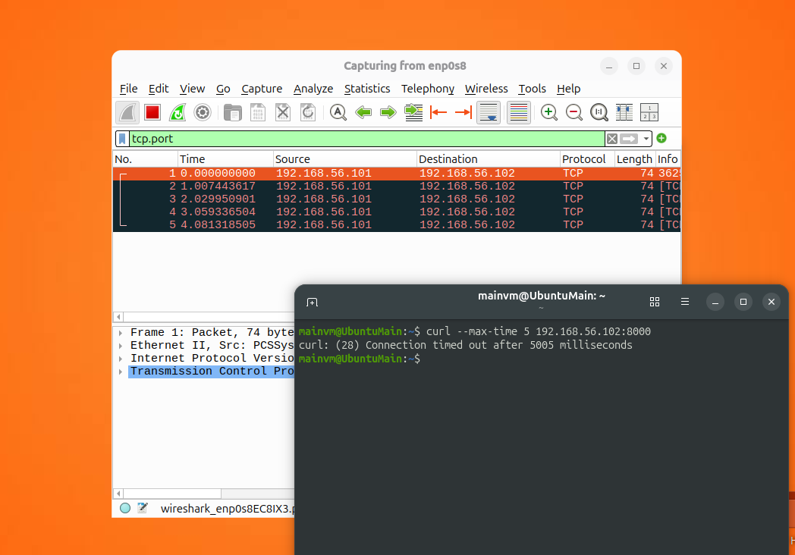
```
curl --max-time 5 192.168.56.102:8000
```
As a result, Wireshark captured 4 SYN signals, no ACK at all 

## Connecting to allowed tcp port
Now restarting test server, this time with ufw allowed tcp on 8000 port

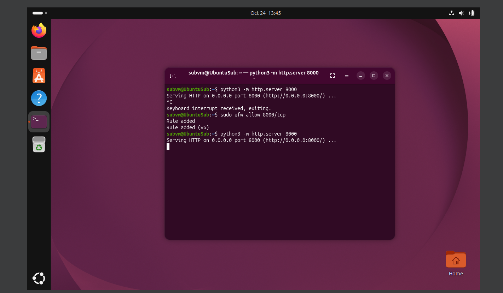
```
sudo ufw allow 8000/tcp
python3 -m http.server 8000
```
Then re-enabling Wireshark capturing again and trying to curl
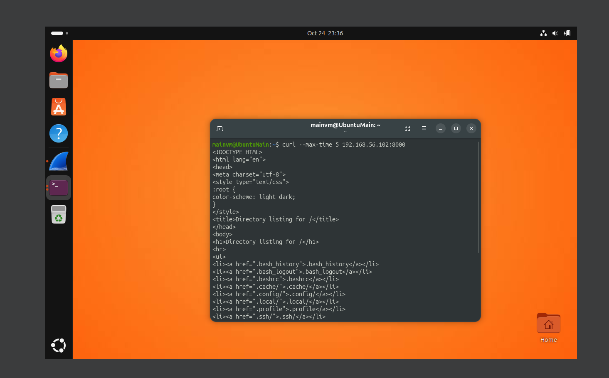
```
curl --max-time 5 192.168.56.102:8000
```
Terminal shows up HTML of test server. Checking up WS capture
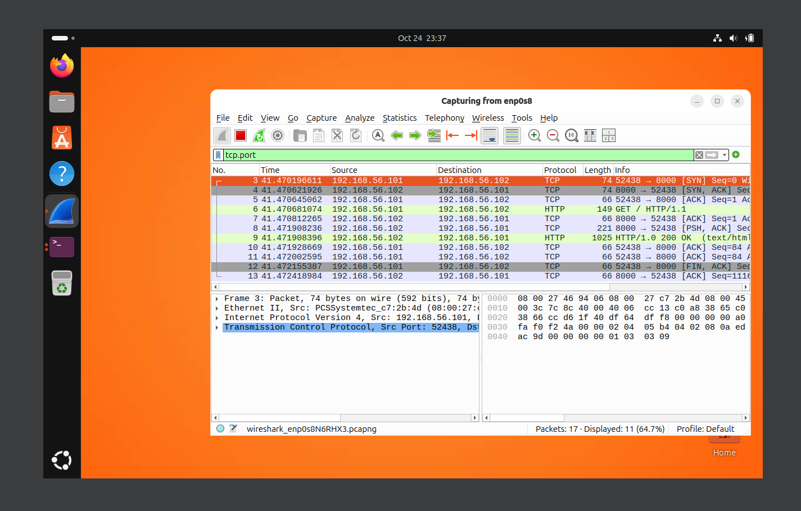

Wireshark shows up few lines that contains both SYN and ACK, so in conclusion we have connection established.
## Problems and conclusions
Problems:

Conclusions:
